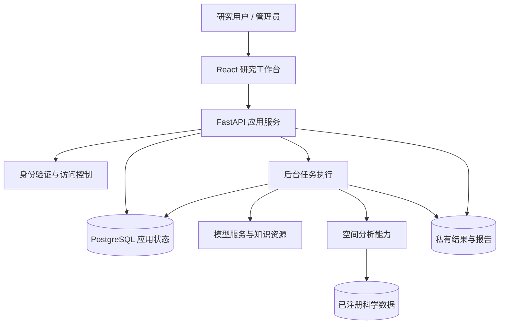

# 架构概览

此图仅描述用户可理解的模块职责和主要依赖，不展示内部决策与记忆算法、数据库表结构、部署地址或核心实现。

## 模块职责

| 模块 | 职责 |
| --- | --- |
| 研究工作台 | 对话、确认、状态展示、结果查看和管理界面 |
| 应用服务 | 接收请求、校验用户权限、组织应用操作 |
| 后台任务 | 执行较长操作，并记录任务进展和结果 |
| 模型与知识资源 | 理解和解释研究问题，提供有依据的问答支持 |
| 空间分析能力 | 按研究条件调用科学计算能力 |
| 应用状态与文件存储 | 分别保存结构化应用信息、报告及空间结果 |

## 设计原则

1. 正式分析由用户核对研究条件后确认。
2. 模型生成的解释与科学计算结果保持职责区分。
3. 每个账号拥有独立研究空间，权限在服务端验证。
4. 数据支持能力与当前部署实际可用资源分别说明。
5. 失败、缺失数据和结果质量限制应当对用户可见。

该图不是已上线的生产拓扑，也不承诺现有版本已支持跨机器弹性调度。部署形态将在目标环境验收后更新。
