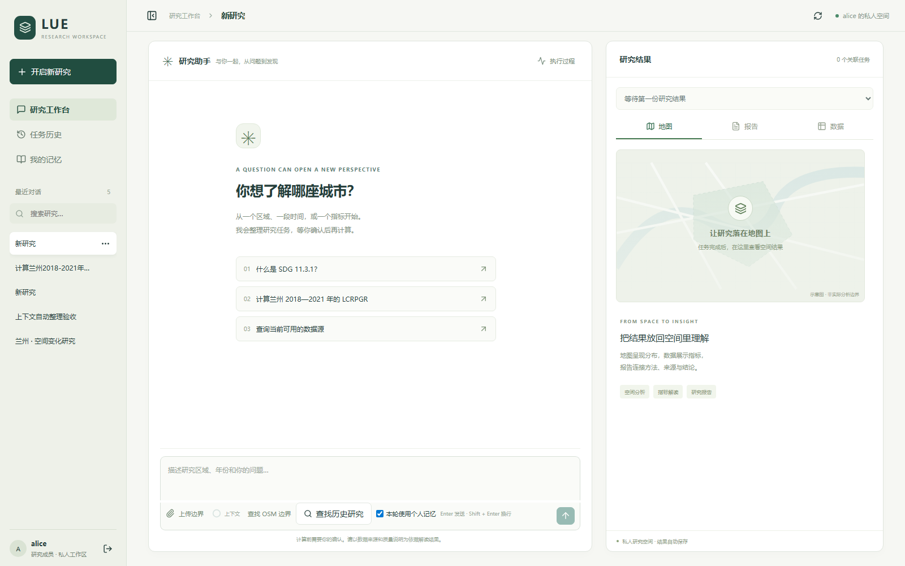
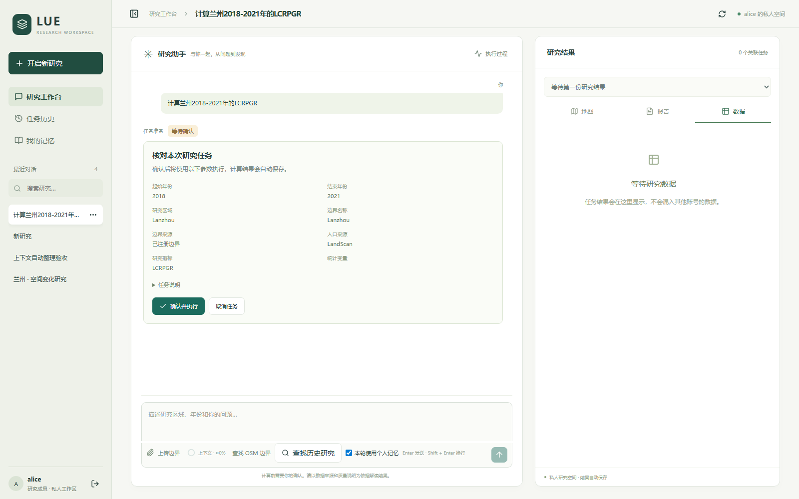
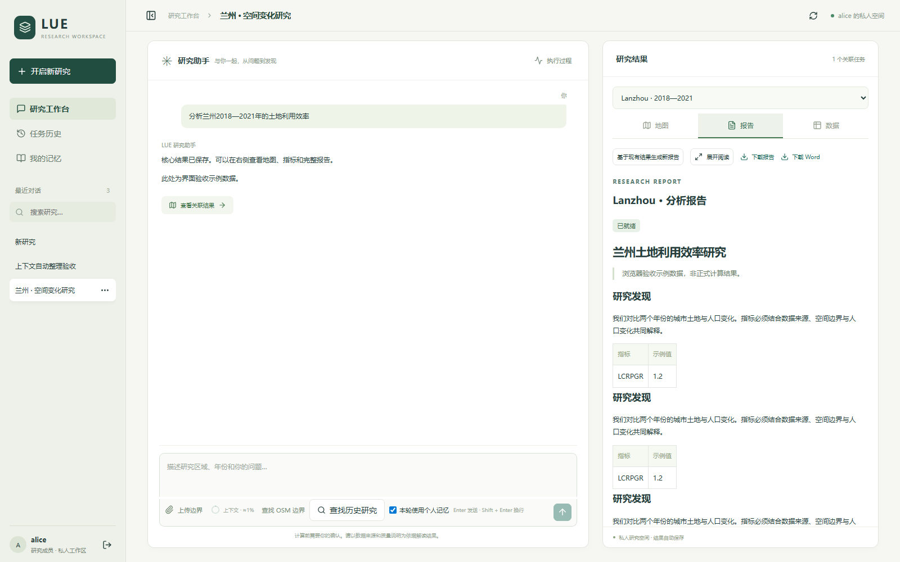
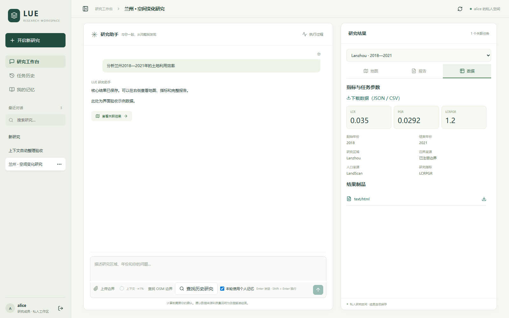
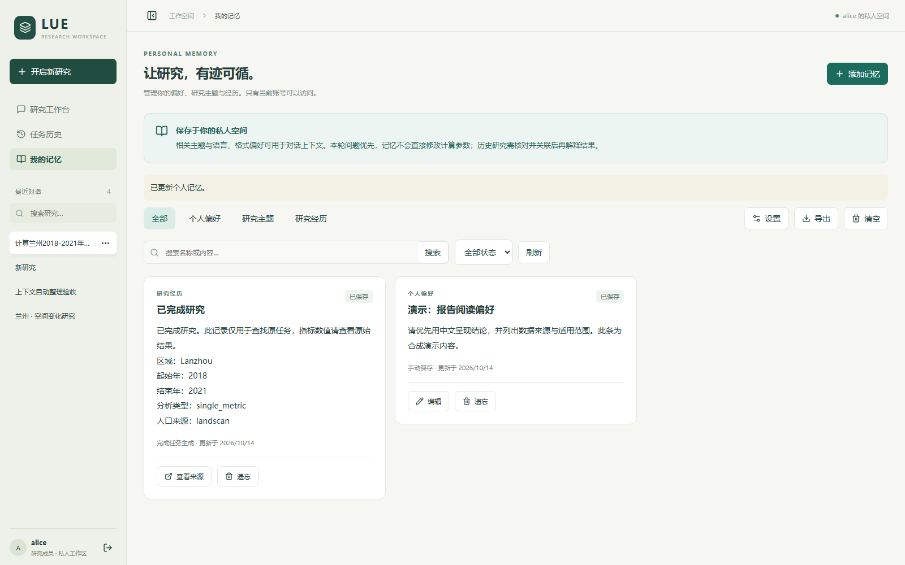
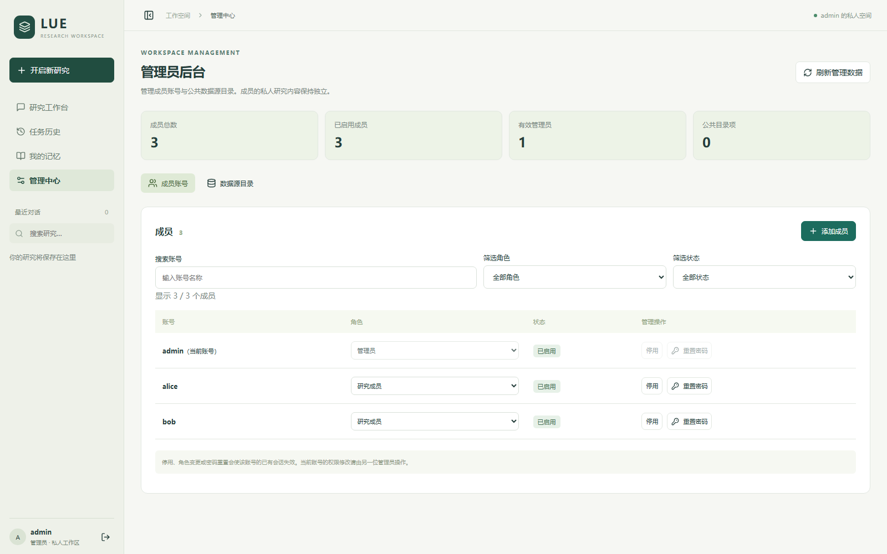

# 界面截图集

拍摄日期：2026-10-14。以下截图来自项目实际 React 界面与隔离的本地测试服务，使用合成账号、对话、研究参数、示例报告和简化边界。后台模型与计算采用测试适配器；本次没有调用真实模型或执行正式 GIS 计算。

截图展示界面布局和交互状态，不作为科学结论、计算精度或线上服务可用性的证据。Alice、Bob 和 admin 均为隔离环境中的演示账号。

## 研究工作台

紧凑标题、侧栏导航，以及并列的对话与研究结果区域。

## 任务确认

研究条件在计算前集中展示，用户核对后才能执行。图中停留在待确认状态，本次没有执行该任务。

## 报告阅读

报告在结果面板内部滚动，保留对话和输入区域。报告中的数值与文字为界面测试样例。

## 数据查看

与报告和地图并列的数据视图，用于核对已关联结果。图中数值为合成示例。

## 个人记忆

展示由用户管理的合成阅读偏好，不含真实个人资料。

## 管理员后台

展示成员管理和公共目录管理入口，账号全部来自隔离测试环境。

## 地图截图待补

本次演示环境的外部底图未能完整加载，因此未将灰色底图截图收入展示。工作台首页的浅色插画是空状态示意图，不是空间分析结果。后续在底图可用时补充专门的地图结果截图。
